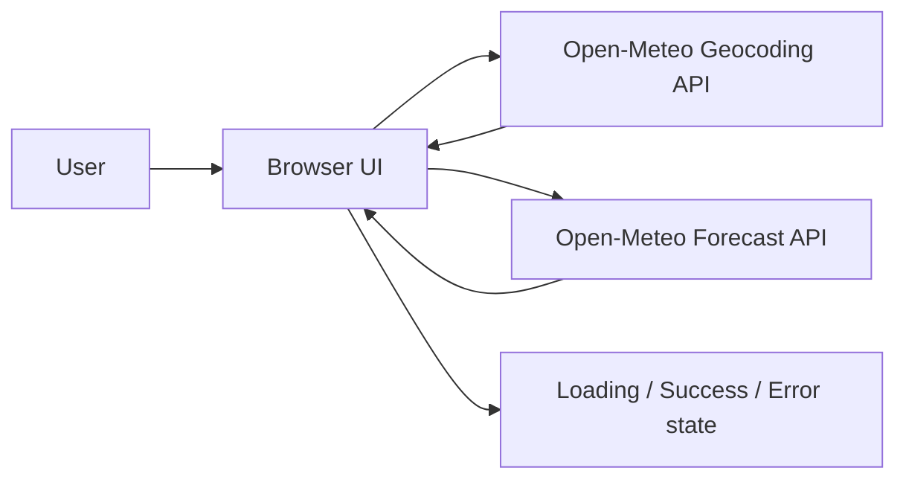

# Capstone Project Master: Weather Lab

## Project objective

Weather Lab turns a city search into a compact current-conditions view. The capstone demonstrates a production-minded frontend workflow: accessible controls, asynchronous API orchestration, explicit loading and error states, responsive design, and deployment documentation.

## System architecture



The browser owns presentation state. Geocoding resolves a city to coordinates, then the forecast endpoint returns current conditions. No API key or server-side secret is required.

## Tech stack

HTML5, CSS3, vanilla JavaScript, Open-Meteo REST APIs, Docker, and GitHub Actions.

## Installation and run

```bash
cd public
python -m http.server 8080
```

Open `http://localhost:8080`. The application requires network access to Open-Meteo. A production deployment can serve `public/` with any static hosting provider.

## API documentation

See `docs/API.md` for request parameters, response fields, and failure behavior.

## Screenshots and demo video

The capture checklist is in `docs/screenshots.md`. Add final PNG captures and a hosted video URL before publishing the capstone.

## Live deployment

- Production URL: `https://replace-with-live-url.example`
- Demo video: `https://replace-with-demo-url.example`

## Quality and security

The app validates empty input, encodes user input with `encodeURIComponent`, renders only known API fields, and exposes no credentials. Run the QA repository tests before release and complete the manual accessibility checklist.
